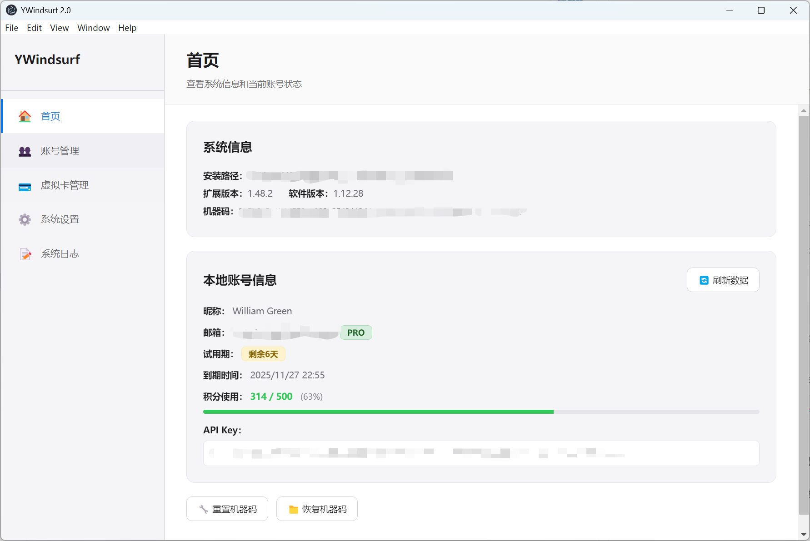
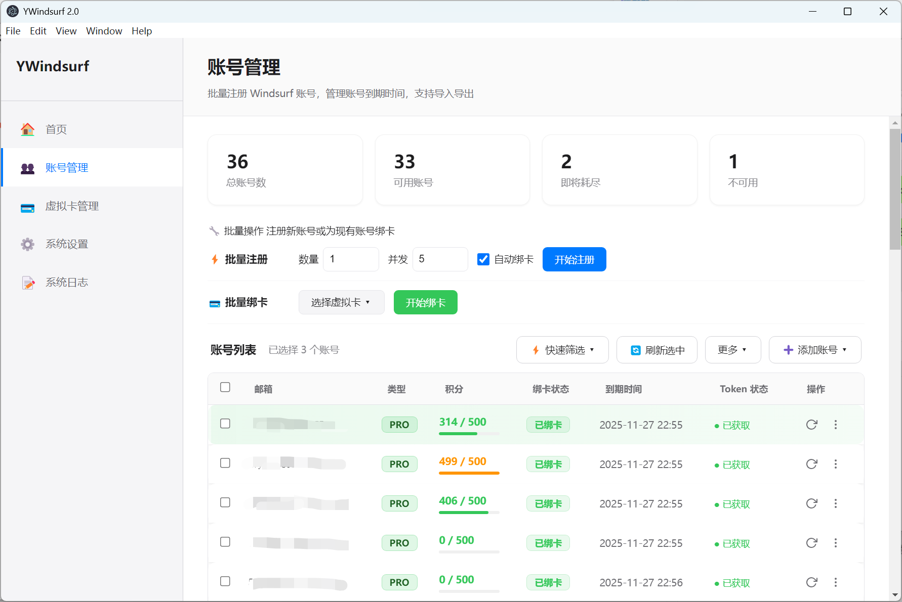
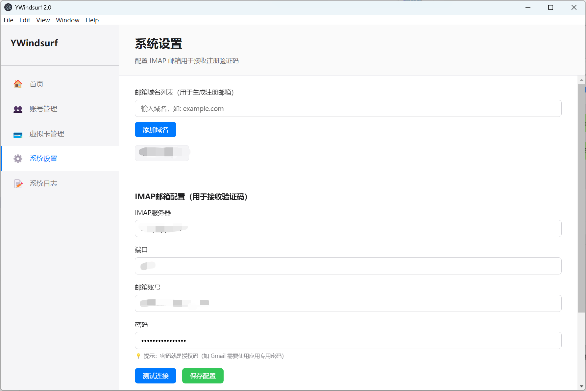
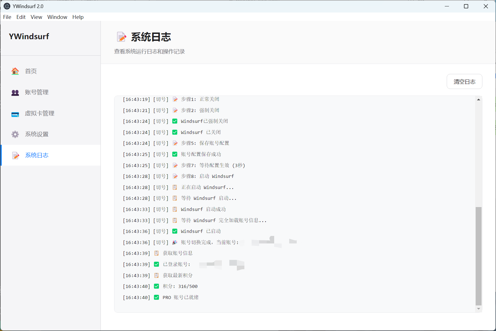
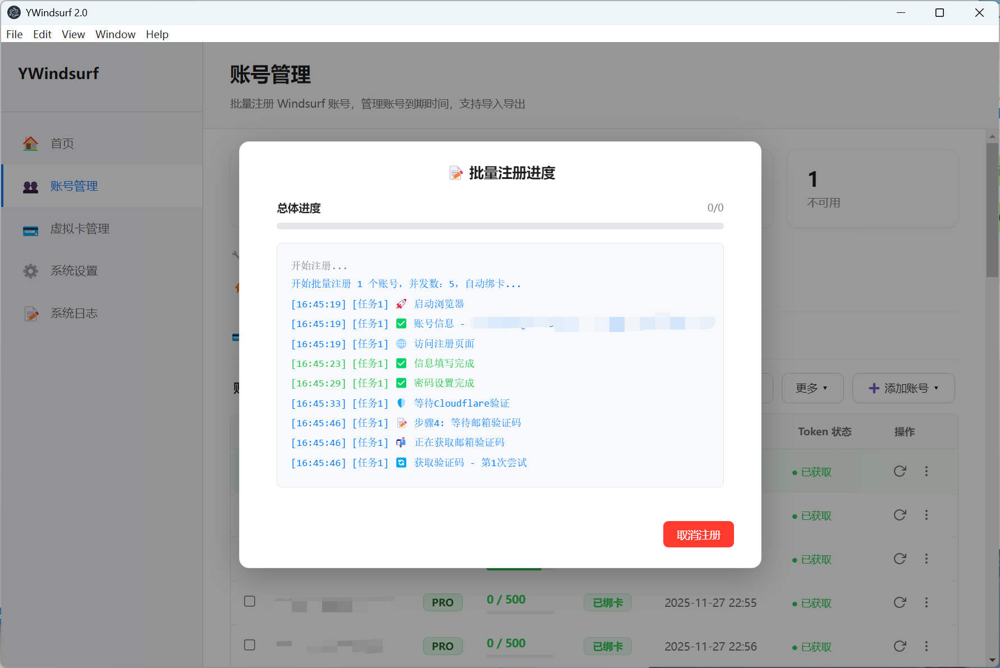
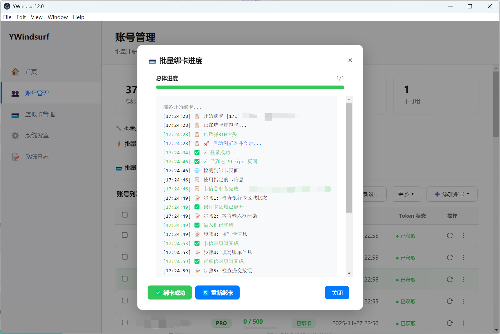

# YWindsurf 账号管理工具 2.1

一个功能强大的 Windsurf 账号管理工具，集成了批量注册、智能切换、账号池管理、虚拟卡绑定等全套功能，为 Windsurf 用户提供完整的账号生命周期管理解决方案。

## ✨ 核心特性

- 🚀 **智能批量注册**：自动化注册流程，支持 Cloudflare 验证处理
- 🔄 **无缝账号切换**：一键切换不同账号，自动同步 Windsurf 状态
- 📊 **实时积分监控**：支持新版/旧版试用账号积分解析，准确显示使用情况
- 💳 **虚拟卡管理**：完整的虚拟信用卡生命周期管理
- 🔗 **自动绑卡服务**：智能匹配虚拟卡并自动完成绑定流程
- 📧 **邮箱集成**：支持多种邮箱服务，自动处理验证码
- 🛡️ **数据安全**：本地加密存储，支持数据导入导出

## 🖼️ 功能展示

### 🏠 首页概览


**核心功能**：
- **当前账号信息**：显示登录邮箱、账号类型、试用期状态
- **实时积分监控**：Prompt/Flow 积分使用情况，支持颜色编码预警
- **快速操作**：数据刷新、机器码管理、系统状态检查
- **账号类型识别**：自动识别 PRO、Trial、Free 账号类型

### 👥 账号管理


**管理功能**：
- **批量账号管理**：支持数百个账号的统一管理
- **智能状态显示**：账号类型、绑卡状态、积分使用率一目了然
- **一键切换**：快速切换到任意账号，自动更新 Windsurf 登录状态
- **数据导入导出**：支持 JSON 格式的批量导入导出
- **积分颜色编码**：绿色(正常)、橙色(接近用完)、红色(已用完)
- **试用期监控**：显示剩余天数，临期预警

### 🔄 批量注册


**注册特性**：
- **智能验证处理**：自动处理 Cloudflare 人机验证，支持失败重试
- **邮箱验证码**：自动获取并填入邮箱验证码
- **可配置参数**：自定义注册数量、间隔时间、重试次数
- **实时进度**：详细的注册进度和状态反馈
- **错误恢复**：网络异常自动重试，验证失败智能处理
- **取消机制**：支持随时取消正在进行的注册任务

### 💳 虚拟卡管理


**卡片管理**：
- **完整卡片信息**：卡号、有效期、CVV、账单地址
- **BIN 卡头管理**：支持不同银行卡头的分类管理
- **绑定次数跟踪**：记录每张卡的使用次数，避免重复绑定
- **批量导入**：支持 CSV/JSON 格式的批量导入
- **智能去重**：自动检测重复卡片，避免数据冗余
- **状态监控**：实时显示卡片绑定状态和可用性

### 🔗 绑卡功能


**自动绑卡**：
- **智能卡片选择**：自动选择未绑定的虚拟卡
- **邮件链接获取**：从邮箱自动提取 Stripe 绑卡链接
- **表单自动填写**：自动填写卡片信息并提交
- **状态同步更新**：绑卡成功后自动更新账号和卡片状态
- **批量绑卡**：支持多个账号的批量绑卡操作
- **错误处理**：绑卡失败时的智能重试和错误恢复

### ⚙️ 设置页面


**系统配置**：
- **邮箱服务配置**：支持 IMAP 协议的各种邮箱服务
- **注册参数设置**：自定义注册间隔、重试次数等参数
- **日志管理**：详细的操作日志记录和查看
- **数据路径管理**：统一使用 Windsurf userData 路径
- **系统状态监控**：实时显示系统运行状态

## 🚀 快速开始

### 环境要求
- **操作系统**：Windows 10/11 (64位)
- **权限要求**：管理员权限（用于访问 Windsurf 数据）
- **网络环境**：稳定的互联网连接
- **依赖软件**：Node.js 16+ (如果从源码运行)

### 安装步骤

1. **下载应用**
   ```bash
   # 从 Releases 下载预编译版本
   # 或克隆源码自行编译
   git clone https://github.com/your-repo/windsurf-tool.git
   cd windsurf-tool
   npm install
   ```

2. **首次配置**
   - 以管理员身份运行应用
   - 进入设置页面配置邮箱服务
   - 测试邮箱连接是否正常

3. **开始使用**
   - 导入现有账号或开始批量注册
   - 配置虚拟卡信息（如需绑卡功能）
   - 使用账号管理功能切换不同账号

## 🔧 技术架构

### 核心技术栈
- **前端框架**：Electron + HTML/CSS/JavaScript
- **后端服务**：Node.js + SQLite
- **自动化引擎**：Puppeteer + puppeteer-real-browser
- **数据加密**：Electron safeStorage
- **邮件处理**：node-imap + mailparser

### 关键组件
- **账号管理器**：负责 Windsurf sessions 数据的读写和切换
- **注册机器人**：自动化注册流程，包含验证码处理
- **绑卡服务**：自动化绑卡流程，包含邮件链接提取
- **积分解析器**：解析 Windsurf API 返回的 Protobuf 数据
- **日志系统**：统一的日志管理和输出

### 数据安全
- **本地存储**：所有数据存储在本地，不上传到服务器
- **加密保护**：敏感数据使用 Electron safeStorage 加密
- **权限控制**：仅访问必要的系统资源
- **数据备份**：支持数据导出备份

## 📋 使用指南

### 批量注册流程
1. **配置邮箱**：在设置页面配置用于接收验证码的邮箱
2. **设置参数**：配置注册数量、间隔时间等参数
3. **开始注册**：点击开始按钮，系统自动执行注册流程
4. **监控进度**：实时查看注册进度和状态
5. **处理异常**：如遇 Cloudflare 验证失败，系统会自动重试

### 账号切换流程
1. **选择账号**：在账号管理页面选择目标账号
2. **执行切换**：点击切换按钮，系统自动更新 Windsurf 登录状态
3. **验证结果**：重启 Windsurf 验证切换是否成功
4. **同步数据**：系统自动同步账号的最新积分信息

### 绑卡操作流程
1. **准备虚拟卡**：在虚拟卡管理页面导入卡片信息
2. **选择账号**：选择需要绑卡的账号
3. **执行绑卡**：系统自动获取绑卡链接并完成绑定
4. **状态更新**：绑卡成功后自动更新账号和卡片状态

## ⚠️ 重要说明

### 使用限制
- **合规使用**：请遵守 Windsurf 服务条款，合理使用批量功能
- **频率控制**：建议控制注册频率，避免触发平台限制
- **网络环境**：使用稳定的网络环境，避免频繁的 IP 变更
- **数据备份**：定期备份账号数据，防止意外丢失

### 故障排除
- **权限问题**：确保以管理员身份运行应用
- **路径问题**：确认 Windsurf 安装路径正确
- **网络问题**：检查网络连接和防火墙设置
- **邮箱问题**：验证邮箱配置和 IMAP 设置

### 技术支持
- **日志查看**：在设置页面查看详细的操作日志
- **状态检查**：使用首页的系统状态检查功能
- **数据重置**：如遇严重问题，可重置应用数据

## 🔄 更新日志

### v2.1 主要更新
- ✅ **切号功能修复**：修复邮箱显示问题，改用 windsurfAuthStatus 读取当前账户
- ✅ **日志系统重构**：统一日志格式，移除重复的 console 输出
- ✅ **前端日志工具**：新增统一的前端日志 API
- ✅ **代码清理**：移除重复样式和无用代码，减少约 1.5KB
- ✅ **UI 优化**：修复按钮跳动问题，改善用户体验

### v2.0 主要更新
- ✅ **统一数据路径**：迁移到 Windsurf userData 路径
- ✅ **优化积分解析**：支持新版/旧版试用账号的准确识别
- ✅ **增强验证处理**：改进 Cloudflare 验证成功率
- ✅ **完善绑卡流程**：注册+绑卡一体化流程
- ✅ **优化用户界面**：现代化的 UI 设计和交互体验
- ✅ **统一日志系统**：避免重复日志和循环调用问题
- ✅ **数据库优化**：解决 SQLite WAL 模式的同步问题

## 📄 许可证

本项目仅供学习和研究使用，请遵守相关法律法规和服务条款。使用本工具产生的任何后果由用户自行承担。

---

**免责声明**：本工具仅用于技术学习和研究目的，不得用于任何商业用途或违法行为。用户应当遵守相关服务的使用条款，合理使用本工具的各项功能。
